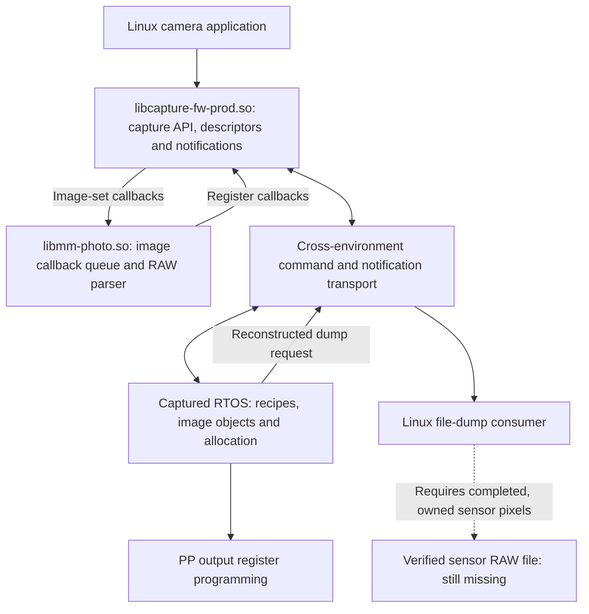

> **Frozen 20 October 2026.** Not the task list. Claims live in `reverse-engineering/facts/`. The open phase is `reverse-engineering/CURRENT_INVESTIGATION.md`.

# Gear 360 capture code: component and reconstruction map

This map covers the captured SM-R210 build and the functions investigated so far. It is a map of selected paths, not a complete catalogue of every library. The detailed reports and their source-bound evidence take precedence over historical notes. No verified sensor RAW frame has been recovered.

## The two software worlds

The Linux camera application uses shared libraries (`.so` files): compiled machine code, exported and internal functions, constants, C++ object tables, and information the loader uses to connect libraries. Their filenames and exported function names help locate features, but do not prove that a feature is active.

The captured RTOS image contains a separate capture implementation. We have followed its image objects, material factories, memory allocator, hardware-register writers, event dispatch and dump requests. Linux addresses and RTOS addresses belong to separate execution environments. A Linux program cannot use an RTOS function address as an ordinary callable function.

Arrows summarize recovered interface relationships; they do not establish a successful live RAW capture. In particular, the active sensor input and completed image identity remain open.

## Where the recovered functions live

Linux addresses below are the Ghidra addresses used in the cited reports. For these library imports, subtract `0x10000` for the investigated ELF virtual addresses. RTOS addresses use the separately established link base `0x80000000`.

| Artifact | Recovered responsibilities and examples | Limit |
| --- | --- | --- |
| `dump/extracted/platform/usr/apps/com.samsung.di-camera-app/bin/di-camera-app` and its resource map | Product-facing capture requests, including crop ioctl `0xa4` and chip-named ioctl `0x8b` | Those request names do not identify the active sensor or supply frame dimensions. |
| `dump/extracted/platform/usr/lib/libcapture-fw-prod.so` | Public/internal topic conversion; single-image `CCapImageCb::OnCallback` `0x9403c`; separate `CCapImageSetCb`; process-local subscriptions; shared descriptor conversion; `onFileDumpRequest` `0xa24c8` → `DumpFileData` `0x627d4`; streamed file-I/O handler `0xa4b24` → `RunAdjustFunction` `0x65b10` | Supporting a RAW enum does not create a RAW producer. The single-image wrapper populates descriptors for three liveview topics. The image-set wrapper has no RAW handler; the separately traced RTOS RAW image-set branch takes its no-export path. |
| `dump/extracted/platform/usr/lib/libmm-photo.so` | Image-generation callback queue, 136-byte descriptor copies, `CaptureDataParser::convertRaw` `0xe1668` | The parser requires descriptor pack type 3. Candidate provider conversion yields type 1; identity or an intervening transformation has not been established. |
| `dump/extracted/platform/usr/lib/libudd5.so` | Hardware DMA-related exports were examined; an identified Linux caller belongs to TINT resizing | This is not evidence that the Linux path owns the candidate RTOS sensor image. |
| `output/decompile/rea/rtos-p6.bin` | Image factory `0x80140e94`; distinct provider entries 13 and 19; MID `0x15000` factory; FrontendNx/CPP_Preview/CPP_Core; contiguous arena; cache service; file-dump producer and ACK dispatch | Active R210 selection, live geometry, sensor input, completed-frame identity and safe export lifetime still need proof. |

The transport functions have been followed across specific requests and replies. A full per-function catalogue of `libmulticore-bridge.so`, `libsif.so`, and every other dependency has not been established; assigning all transport behavior to a filename would overstate the evidence.

Sources: [initial API and sensor findings](SENSOR_RAW_FINDINGS.md), [dump protocol](RAW_DUMP_PROTOCOL.md), [factory and metadata](RAW_FACTORY_FORMAT_AND_SYSCALL.md), [reviewed allocator/output/cache findings](RAW_ARENA_DMA_AND_CACHE.md), [activation/device/export continuation](RAW_ACTIVATION_GEOMETRY_AND_COMPLETION.md), [execution/provenance/geometry corrections](RAW_EXECUTION_PROVENANCE_AND_LIFETIME.md), [interrupt, recipe and conditional geometry route](RAW_INTERRUPT_AND_RECIPE_EXECUTION.md), and [completion identity and recipe-book dispatch](RAW_COMPLETION_IDENTITY_AND_RECIPE_DISPATCH.md). Their evidence indexes bind claims to original input hashes and saved REA records.

## Structure recovered inside the RTOS

We have recovered useful class and object relationships. Some names survive in symbols, RTTI or diagnostic strings; other labels are analyst descriptions.

| Structure | What is established |
| --- | --- |
| Image factory and provider | Selector `0x28` creates a `0xc8`-byte image and requests provider `0x0d` (13), which maps to seeded settings row `0x16` (22). Initialized geometry is 5824×2896; active geometry is unobserved. Separate provider `0x13` (19) uses rows 25/26. Pixel bits, memory packing and pack type are separate fields. |
| Material factory | CManager → CFridge_NX1 → Still → Still_PP routes MID family `0x150xx` to `CMaterial_PP_Core_Liveview_VideoFull_Adjust`. This is a static factory result, not proof of the active camera recipe. |
| Recipe containers and callbacks | CRecipe holds CProcedure children, each holding materials. CCook create calls BranchManager virtual +8, which is `0x8027b888` and selects a Still, Liveview, or QView recipe book from the recipe id's top byte. That target is not MID builder `0x802ba7b4`. Assistant cases1/2 reach material +0x10. Material +0x18 reaches frontend `StartVideoStream` with a 16-byte parameter record, not a pixel pointer. The active book remains unknown. |
| Material image table | Six 12-byte rows at material byte `+0x140`; row tag 3 can carry image slot zero into the frontend. |
| Output receivers | Allocated FrontendNx C → fixed CPP_Preview B → fixed CPP_Core A. Descriptor-pointer continuity from candidate slot0 is conditional on the secondary copier and C+0x204==0; tag4 can overwrite the route despite being disabled. The gate defaults to zero; the conditional candidate rows select Core mode4 and primary dimensions. Pixel memory is read from the descriptor wrapper, not its object address. |
| Frontend device binding | The compiled factory/config path stores a `CS5K2M8SXDriver` object at FrontendNx `+0x250`. Physical sensor identity and invocation on the R210 remain unobserved. Device modes and provider roles are separate identifiers. |
| Output programming | CPP_Core output0 supplies address, stride and dimensions to PP WDMA register writers. This proves software programming, not completed DMA or sensor provenance. |
| Completion delivery | Pending register 0x20800018 bit6 selects callback table 0x8144a798, then the software PP_WDMA0 route reaches event mask8 on the same frontend instance. Acknowledgement follows callback return; hardware semantics and frame freshness remain unverified. |
| Memory manager | A reusable arena starts at configured base `0xa6000000`. The candidate state requests 64 MiB in contiguous 16-KiB units. Actual allocation index is dynamic. |
| Release and dump | A recipe-time flag can install DumpSize for the exact candidate image and pass its PData to FileDump. Candidate material teardown deletes the image object without proving arena-backing release. The separate Ipc_End backing-release path is not bound to this candidate. FileDump's ACK supplies no pixel-buffer lease or successful-file guarantee. |

## What REA produces, and the path to C/C++

REA coordinates analysis tools and retains evidence. For these native binaries, Ghidra provides disassembly, C-like pseudocode, cross references and reconstructed functions. Saved snapshots preserve the analysis state; source hashes and byte windows bind the interpretation to captured inputs. The RTOS analysis carriers add ELF metadata around selected unchanged bytes so the tools can analyze them; those carriers are never executed.

Decompiler output is a draft interpretation. Pointer types, argument counts, object boundaries and virtual calls require checking against instructions. This investigation has already corrected scaled pointer offsets, temporary versus final vtables, and data mistaken for code. We do not possess the original C++ source simply because a function decompiles.

The practical reconstruction path is to recover one contract, express its fixed-width fields and behavior in readable C/C++, and validate it against evidence. The existing [offline descriptor inspector and row splitter](../raw-buffer-prototype/README.md) does this for saved dump bytes and the separate shared image descriptor. It compiles and preserves the recovered row-copy behavior, but does not acquire camera pixels. Its parser-guard result is not a frame-validity test.

An acquisition implementation still needs a proven active route, actual dimensions/format/address, sensor-derived completed output, and ownership lasting through the copy. Only then can a saved image be checked for expected size, Bayer content, sample packing and correspondence to the camera sensors. Counting recovered functions cannot provide a reliable percentage of progress toward that final result.
