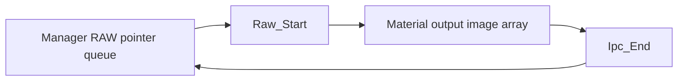

> **Frozen 20 October 2026.** Not the task list. Claims live in `reverse-engineering/facts/`. The open phase is `reverse-engineering/CURRENT_INVESTIGATION.md`.

# RAW buffer lifecycle and dump transport continuation

The later [arena, derived-output and lifetime review](RAW_ARENA_DMA_AND_CACHE.md) resolves the concrete allocator/cache service and shows that Ipc_End attempts pixel-backing release and clears its descriptor before requeueing the image object. Earlier container-removal observations below do not imply pixel retention.

Updated 2026-10-14 (Australia/Sydney). This continues [the first sensor RAW pass](SENSOR_RAW_FINDINGS.md). All results are static reconstructions from the captured SM-R210 binaries. No live camera command, restart, register write, firmware execution, or deployment occurred.

**Later continuation:** [RAW dump protocol and diagnostic activation](RAW_DUMP_PROTOCOL.md) closes both static request/completion mappings, recovers initialized dispatch tables, and connects the diagnostic flag to the dump guard. Its findings supersede the delivery/ACK and flag-link unknowns below. Actual sensor provenance and live capture remain unresolved.

## What changed

The investigation now has three concrete pieces: a recovered RAW-image pointer lifecycle, firmware code that can dump RAW-tagged image bytes, and Linux handlers for both whole-buffer dumps and streamed file-operation requests. A compiled [offline C++ prototype](../raw-buffer-prototype/README.md) implements the verified descriptor and front/rear row-copy contracts.

**No actual sensor RAW frame has been extracted.** The active frame format, the token's producer, diagnostic command registration, and parts of request delivery still need validation. Matching producer/consumer code is stronger than a named enum, but does not observe execution.

## RAW allocation, format, and ownership

RTOS `0x80140e94` allocates a `0xc8`-byte image object and invokes default constructor `0x8025c620` or copy constructor `0x8025c808`. Selector `0x33` enters configurator `0x801420d8`, which requests image information through `0x8020c14c` using role `0x1b` or `0x1c`, according to the manager selection.

The configurator reads **memory packing** enum `image+0x59` through `0x80541a58`: values 0/1/2/3/default map to 8/10/12/14/16 bits. It calculates the stride as:

```text
temporary = (packing_bits * configured_width) >> 4
temporary = align_up(temporary, 16)
stride = temporary * 2
```

This is the recovered integer arithmetic, including its initial shift/truncation. It is not an independently measured camera-frame stride.

Separately, `0x801ddc20` uses getter `0x80541a30`, which reads **pixel-bit** enum `+0x58` and maps it to 8/10/12/14/16. The later [class and descriptor review](RAW_FACTORY_FORMAT_AND_SYSCALL.md) identifies this method as `CBackend_Ipc_Ctrl_View_Sra_Output`, an IPC SRA output control. Its former SSIF/DMA label is withdrawn; its descriptor receivers have not been tied to a sensor receive buffer. Pixel/sample bits and memory packing are different fields.

The manager's RAW queue at `this+0x6c` is a pointer ring with capacity `+4`, count `+8`, write index `+0xc`, read index `+0x10`, and pointer storage `+0x14`. Append `0x8013da58` and pop `0x8013d910` adjust those fields. Neither copies pixel data or increments a reference count.

`Raw_Start` at `0x8032b96c` pops the queue through `GetRaw` (`0x8013bad4`), clears embedded-buffer size `+0x28`, then appends the image pointer to material output storage through `0x80251b40`. `Ipc_End` (`0x8032be1c`) retrieves an output image, places it back in `SetMainRawImage`, and removes it from the material via `0x80251c9c`. Removal shifts the output pointer array and decrements its count; it does not free the image. The static pointer cycle is therefore:



Ownership transfer is inferred from insertion/removal order. The image's allocation, release, and cache contract remains partly open. Embedded-buffer copy `0x800b4cec` copies metadata and address structures, not pixels or a retained buffer reference.

## Front/rear SSIF dump

RTOS `0x80282760` looks up material token `0x15000` through `0x802596f4`, then gets output image zero. It obtains buffer address `B`, full row stride `S`, and height `H`.

Writer `0x801e516c` opens a binary file, writes `S/2` bytes per row, and advances its source by the full `S`. The front file begins at `B`; the rear file begins at `B+S/2`. Each file should therefore contain `H*S/2` bytes if all writes succeed. The writer performs no pixel conversion.

The hardcoded filename includes `10bit(16bit).raw`. **That label does not measure the actual frame's pixel/packing fields.** The dump also has runtime guards, including singleton byte `+0x19` read by `0x80573cec` and an additional image-mode condition. The singleton constructor clears the dump flag. A parser recognizes `ssifdump` and changes the flag for on/off. Its full user-facing command registration has not been established.

Token `0x15000` is a graph/material lookup, not a direct allocation ID: getter `0x802596f4` traverses child objects and recursively searches through `0x80257e00`. The producer and actual format of that selected image remain unresolved.

Other parser entries at `0x8022c928` recognize `ssifraw`, `rawbit`, and `rawpack`, setting properties `0x7c/0x7d/0x7e`. These are static parameter assignments; their reachability and effect on an actual R210 shot are not demonstrated. Do not repeat the historical RAW-quality capture merely because these names exist.

## Two file-transfer contracts

### Whole-buffer descriptor dump

A newly traced, separate route is concrete:

`CAdjustAdapter::dumpImage` (`0x8004d558`) checks its dump mask and image format. For format 1 it constructs a Bayer filename from the actual pixel-bit, packing-bit/type, and geometry fields, then calls wrapper `0x80051618` with image-buffer address and `stride*height`.

The wrapper calls `FileDump` at `0x8010ccd8`, which constructs this descriptor:

| Offset | Field |
| --- | --- |
| `+0x00` | Filename, 64 bytes |
| `+0x40` | Image-buffer address, 32 bits |
| `+0x44` | Byte count, 32 bits |
| `+0x48` | Suffix flag, 32 bits |
| Total | `0x4c` bytes |

It invokes memory-manager virtual operations on both descriptor and pixel buffer before publishing, consistent with cache maintenance; the exact virtual implementation has not been traced. It publishes event `0x01070005` through `0x8006eaf0`, and waits on a semaphore at its callback-interface object `+4`. The original formatter names that event `CAPTURE_TOPIC_ID_NOTIFY_OP_FILE_SAVE`.

Linux `CNotifyHandler::onFileDumpRequest` (`0xa24c8`) accepts a four-byte descriptor address and calls `DumpFileData` (`0x627d4`). It maps the `0x4c` descriptor and its buffer through `/dev/mem`, writes the bytes to the named file, then sends MCB command `0x105`. The RTOS command inventory names its corresponding operation `DUMP_ACK`.

The descriptor producer and consumer layouts match exactly. The intervening event/packet mapping and complete ACK handler still need tracing; no live delivery has been observed. This route gives a practical alternative to the unsupported MAIN_RAW callback wrapper.

### Streamed SSIF file operations

The SSIF row writer uses a different front end: open/write/close wrappers `0x800522d0/0x80052350/0x800523fc` call request entries `0x8004e990/0x8004eb04/0x8004ec74`. They use operation selectors `0x0c/0x0e/0x11` and a **32-byte request record**.

The broker copies/flushes that request and submits command family `0x82`, selector `0xaa06`, with a four-byte payload sourced from the request-address member. It constructs a request object, either sends through an immediate path or enqueues it, and waits. The queue's final execution routine is not yet traced. An earlier “local RTOS file” classification was withdrawn after following this broker.

Linux `CNotifyHandler::onFileIORequest` (`0xa4b24`) takes a four-byte address and calls `RunAdjustFunction` (`0x65b10`). That function maps a **32-byte request**, and its operations match:

| Operation | Linux action |
| --- | --- |
| `0x0c` | Map filename/mode addresses, call `fopen` |
| `0x0e` | Map buffer address/length, call `fwrite` using opaque file handle |
| `0x11` | Call `fclose` using opaque handle |
| Response | Send MCB command `0xaa0b` with a four-byte result |

These matching selectors, layouts, and Linux operations support a cross-core file-I/O contract. They do not prove the remaining queue/packet delivery edge or an actual successful SSIF dump. The returned Linux file-handle token must not be dereferenced as an RTOS object.

The two routes should remain distinct: `FileDump/DumpFileData` carries one whole-buffer descriptor; the SSIF row writer issues file-operation requests. Neither requires the normal JPEG image-set callback.

## Why ordinary RAW subscription still fails

Linux `CCapturePublisher::Subscribe(IImageCallback*)` only inserts a process-local topic/listener pair. It does not ask firmware to produce or export RAW. A complete LLVM direct-call scan found only the three liveview setters calling its single-image `Publish` overload.

The RTOS now also reveals the corresponding encoded/YCC ring **writers**: `SetStillImageYccData` at `0x80060fb8` writes `0xd70` bytes to `0x1c54+slot*0xf00`; `SetStillImageEncData` at `0x80061158` writes the same size to `0x19354+slot*0xf00`. Each updates a modulo-25 position and ready flag. This closes the previously open producer/consumer edge for those image-set records.

RTOS `transmitImageSetCallback` at `0x800609f8` has an eight-entry jump table. The RAW image-set case `0x03010002` reaches the default/no-export branch; it does not stage a RAW descriptor. This is a bounded finding for that function, independently corroborating the Linux wrapper's gap. [Original jump-table bytes](../image-set-routing-evidence.json) and [the file-dump event binding](../filedump-event-evidence.json) are retained beside this report.

## Prototype and validation

[ssif_dump.cpp](../raw-buffer-prototype/ssif_dump.cpp) defines the fixed-width dump descriptor, inspects saved descriptor files as little endian, and splits saved SSIF buffers into byte-preserving front/rear files. It does not map camera memory or fetch sensor data.

It compiled with the existing Apple C++17 compiler with warnings treated as errors. Synthetic row-order and descriptor fixtures were compared byte-for-byte. Zero/odd stride, zero height, truncated input, and oversized geometry were rejected. Carrier generation preserved the original default digest and reproduced the custom view deterministically; overlapping, writable, and out-of-range custom configurations were rejected.

The carrier builder now accepts `--config` for focused ranges and analyst symbols, so future passes can add only the code/data needed for a concrete question. Every segment remains bound to original bytes and SHA-256.

## Evidence and saved state

Original RTOS digest remains `cfe69efe127b2ae16368e96fb0ae8893570a4e3d94a87fd14ccbc6aeba3e8cd7`; Linux capture library remains `fba8947358ff1fd666fca794d2af77e77a61964e5dd022c04c499ae7b4cc8cc7`. ARM/Ghidra pseudocode types are inferred; original-byte traces were used to correct field/name ambiguities.

Full outputs, byte traces, partial-carrier manifests, independent Ghidra project, and snapshots are under local `output/decompile/rea/continuation-20261014/`. Its subdirectories separate raw allocation, sensor/DMA, Linux transport, and the two Luna investigations. Native targets were closed with snapshots.

| Finding | REA Evidence |
| --- | --- |
| Image constructor/configuration | `ev_dfd0f4f4b7ca28bad22a21b0dff87013531ef637613dc44160725b628868260a`, `ev_c52243a47b2b575f490aaa7b66564ce353f0f38d4c2cff8f96ce6b2b006f33aa` |
| RAW queue/material lifecycle | `ev_46a2b97c1c8600bcaf0303c3d4dadc33c58c3a048e68b3a0002ac3d9065dcd74`, `ev_f115f0db901568850ab0606c1cfccd9ad42490db8760ed4ef75391e93f2d3672` |
| SSIF row writer | `ev_e63026a0a190e82c40e6535889bf6c1fa3f5a85bc7929ea8999130cc5eabd536` |
| Linux subscription | `ev_764dca1ee6eff38975b4f3140217a479c85f8b1ff218ca6b3d37009774e9b469` |
| Linux descriptor dump | `ev_1dcbf1bcc88d91bd974ca807cd63f12a76065f48e74b44d1c2c9975ca9accf84` |
| RTOS whole-buffer dump producer | `ev_581a5b9766175fa60ba6e76b7324bdbb6783733d2e2796f898fc2ca7b646c829` |
| Whole-buffer dump forwarding wrapper | `ev_ed1ea53af87a7a39dc54464e8e889992865cd35b41a3ee09fb90a918b5c06895` |
| RTOS streamed file-operation packaging | `ev_9b466680384703072ff2502d4291562ebd7f1c72e758b581f4d69e213d71f314`, `ev_2209dde6a08743f836e1000a9fa6ef29e2cfccbfe4682017cde5c0755f7212fd` |
| Linux streamed IO executor | `ev_d169454f9e5a9c448478c0685ec42005fcd55a10389c7e870daafb5c7499bac3` |
| Image-set writers/jump table | `ev_a1b2e0969f2e5374821c4f6558f1a59e0df9e52327b568a58b6534db6402c6ed`, `ev_05f5aad31e3d6034d5cdfe87f43d16aecd2d6b35d5bbc70ffe4b4c251502489f` |

Usage checkpoints recorded the original window at 61%, 80%, and 92% used, then workers reported the account limit. After the user's request to continue with Luna, the account reported a refreshed window. Luna completed the bounded audit, compiled prototype, and file-operation broker tracing. Account reset credits were not consumed.

## Next decisive checks

1. Trace the queued request executor and the event/packet mapping for `0x01070005` and `0xaa06`, including `0x105/0xaa0b` completion handling.
2. Connect token `0x15000` to an actual SSIF output producer and determine its runtime pixel bits, packing, Bayer layout, geometry, physical address, and lifetime.
3. Verify diagnostic parser registration and a narrow dump activation route. Then design a live validation with a known JPEG positive control and the existing healthy app, preserving the recovery constraint against preload/service restarts.
4. Only after obtaining a real saved buffer, validate byte counts, crop/padding, Bayer content, and sensor provenance. The offline prototype can inspect/copy that buffer but does not establish its source.
